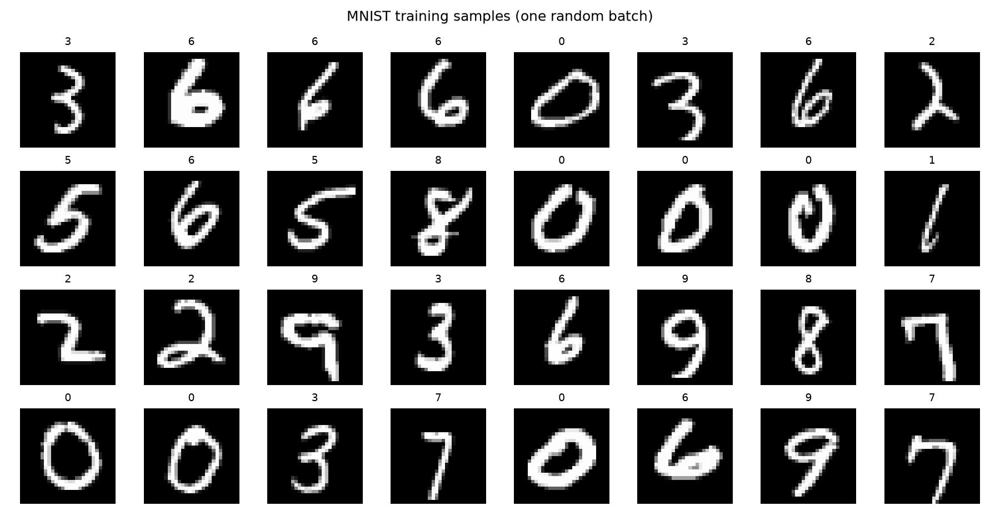
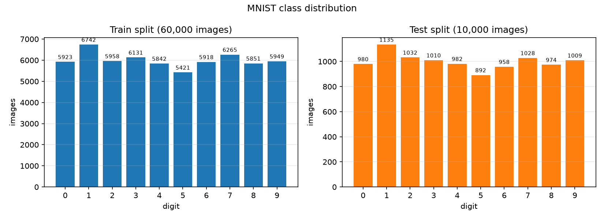
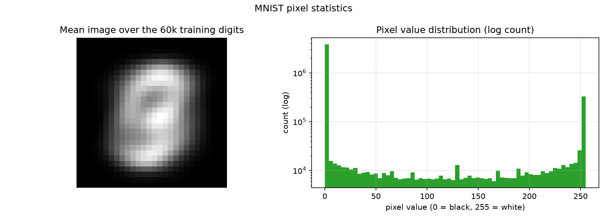
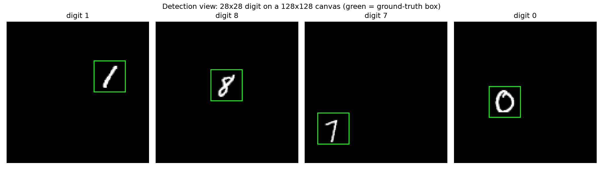
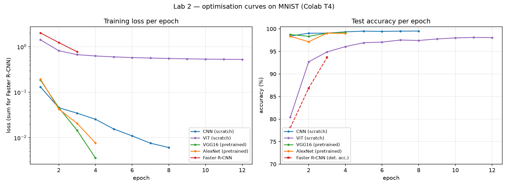
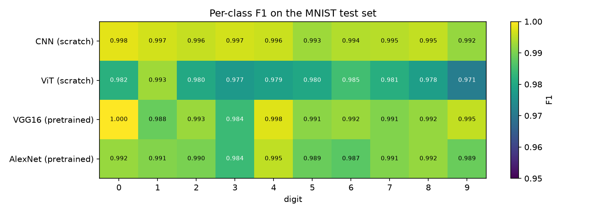
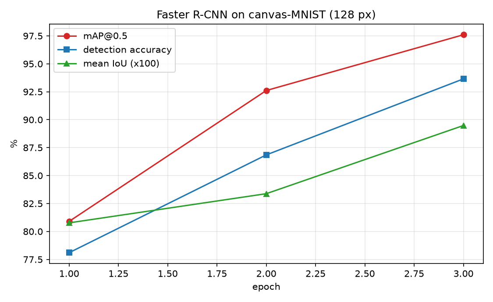
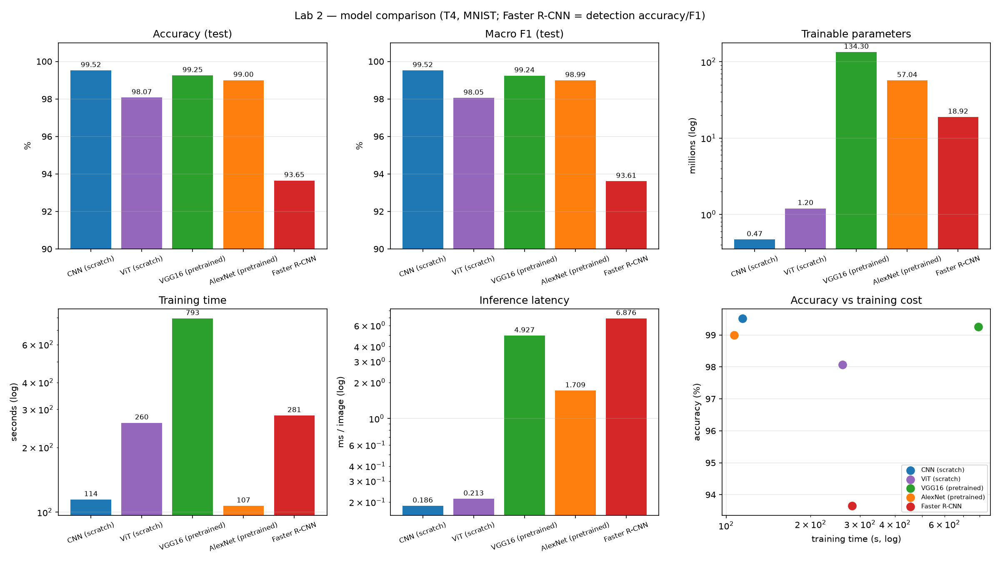
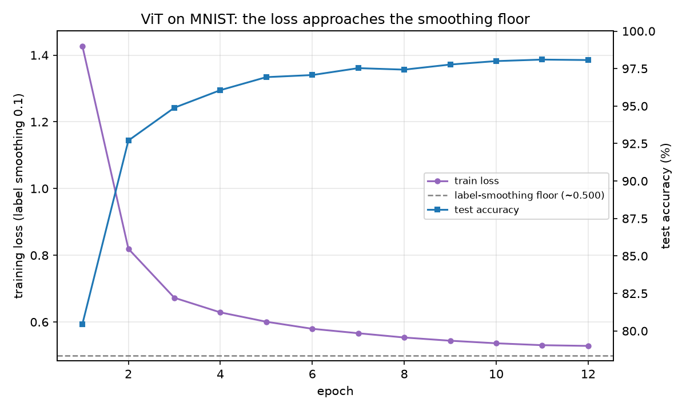
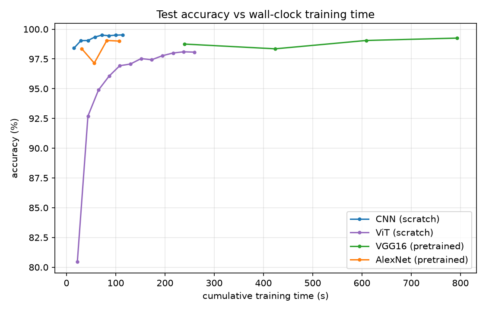

# Deep Learning Lab 2 - PyTorch

This is my lab work for the Deep Learning course (LSI, FST Tanger -
Université Abdelmalek Essaadi, Pr. ELAACHAK Lotfi).

I used PyTorch to do two tasks:

- **Part 1 (computer vision):** classify MNIST digits with a CNN built from
  scratch, solve the same dataset as a detection problem with Faster R-CNN, and
  fine-tune the pretrained VGG16 and AlexNet on MNIST.
- **Part 2 (Vision Transformer):** implement a ViT from scratch following the
  Medium tutorial and use it to classify MNIST.

In both parts I followed the same steps: look at the data (EDA), preprocess it,
build the model with `nn.Module`, choose the layers and hyper-parameters, train
on GPU, draw the Loss/Epochs and Accuracy/Epochs curves, and compare the models
with accuracy, F1, loss and training time.

I did the trainings on Google Colab with a free T4 GPU, because my laptop has no
GPU. The code automatically uses CUDA if it is available, otherwise the CPU.
I fixed the seed to 0 so the results are repeatable. The Colab runs are driven
from WSL with the Colab CLI: one model per `colab exec`, and each JSON report is
downloaded immediately.

## Repository structure

```
lab2/
  src/
    data.py      # MNIST classifiers + canvas detection dataset
    models.py    # SmallCNN, ViT, Faster R-CNN, VGG16, AlexNet
    metrics.py   # confusion matrix, macro F1, IoU, AP@0.5 (NumPy only)
    train.py     # one CLI: --model cnn|vit|vgg16|alexnet|frcnn
    utils.py     # seed, device, timer, JSON, environment info
  scripts/
    colab_run.sh    # WSL/Colab CLI driver (setup + one stage per exec)
    colab_runner.py # remote stage definitions and execution
    colab_smoke.py  # one-batch GPU check for the pretrained models
    make_eda.py     # EDA figures
    make_figures.py # result figures from results/*.json
    summarize.py    # console summary of the reports
  results/
    cnn.json, vit.json, frcnn.json, vgg16.json, alexnet.json
    figures/     # EDA, curves, comparison, per-class F1
  requirements.txt
  README.md
```

## How to run

```bash
pip install -r requirements.txt

# local CPU smoke test (no GPU needed)
python src/train.py --model cnn --epochs 1 --max-batches 2 \
  --train-subset 512 --test-subset 256 --num-workers 0

# full runs on a Colab T4, from WSL
bash scripts/colab_run.sh

# rebuild the figures from the saved JSONs
python scripts/make_eda.py
python scripts/make_figures.py
```

The MNIST data is downloaded automatically by torchvision into `data/` if it is
missing. The numbers below come from the JSON files in `results/`, so they can
be checked.

Environment actually used: Tesla T4 (16 GB), PyTorch 2.11.0+cu130,
torchvision 0.26.0+cu130, Python 3.12, Colab CLI 0.7.5 (WSL).

---

# Part 1 - CNN, Faster R-CNN, VGG16 and AlexNet

## 1) Dataset and EDA

MNIST has 60,000 training and 10,000 test images, 28x28 pixels, grayscale, with
10 classes. It is approximately balanced: from 5,421 to 6,742 images per digit
in train, and from 892 to 1,135 in test. I use `torchvision.datasets.MNIST`,
which downloads the same 60k/10k split as the Kaggle release linked in the lab.



A random batch of training images. The digits are centered and white on black,
with almost no background noise. This is exactly the structure a convolution is
good at, so I expect a small CNN to work very well here.



The class distribution in both splits. The classes are almost balanced, so
accuracy and macro F1 give almost the same ranking. I report both, but I do not
need class weights.



Left: the mean image of the 60k training digits. It is blurry because every
digit is different, but it shows that the ink is always in the center and the
borders are almost always black. Right: most pixels are exactly 0 (background)
or close to 255 (ink); the intermediate values are just anti-aliasing. A
convolution with a small kernel is a good match for this structure.

For Faster R-CNN, MNIST is a classification dataset, so I had to reformulate it
as detection: paste the 28x28 digit at a random position on a 128x128 black
canvas and use the digit rectangle as the ground-truth box.



Four examples of the canvas dataset with the ground-truth box in green. The
position is random but fixed by a seed, so the train and test sets do not change
between runs. The digit is now a small object in a large image, which is the
kind of input a detector expects.

## 2) CNN architecture

I built a small VGG-style CNN:

| Layer | Configuration | Output |
|---|---|---|
| Conv2d | 1→32, kernel 3, stride 1, padding 1 | 32×28×28 |
| BatchNorm + ReLU | — | 32×28×28 |
| Conv2d | 32→32, kernel 3, stride 1, padding 1 | 32×28×28 |
| BatchNorm + ReLU | — | 32×28×28 |
| MaxPool2d | kernel 2, stride 2 | 32×14×14 |
| Conv2d | 32→64, kernel 3, stride 1, padding 1 | 64×14×14 |
| BatchNorm + ReLU | — | 64×14×14 |
| Conv2d | 64→64, kernel 3, stride 1, padding 1 | 64×14×14 |
| BatchNorm + ReLU | — | 64×14×14 |
| MaxPool2d | kernel 2, stride 2 | 64×7×7 |
| Flatten | — | 3,136 |
| Linear + ReLU + Dropout | 3,136→128, dropout 0.25 | 128 |
| Linear | 128→10 | 10 |

The choices:

- **3x3 kernels with padding 1** keep the spatial size after each convolution,
  so all the reduction comes from the two 2x2 max-pools.
- **Two convolutions per block** (32 then 64 filters) increase the receptive
  field before each pool.
- **BatchNorm after every convolution** stabilizes the training and allows Adam
  with lr 1e-3.
- **Dropout 0.25 before the final layer** is the explicit regularizer; I also
  use weight decay 1e-4.
- **64x7x7 = 3,136 features** are flattened into a 128-unit layer, then 10
  outputs.
- The model has **468,202** parameters.

## 3) Training and curves

Adam with lr 1e-3, weight decay 1e-4, batch size 128, 8 epochs, cosine
learning-rate schedule, cross-entropy loss, no data augmentation.

I did not run GridSearchCV here (unlike the MLP lab): the five models have
different input pipelines and the Colab budget is limited. I used the standard
settings from the tutorial/torchvision and kept them fixed, so the comparison is
about architectures, not about tuning. The exact configuration is stored in
`results/cnn.json`.



Left: training loss. Right: test accuracy (Faster R-CNN is the dashed curve, its
own task). The CNN learns very fast: 98.41% after one epoch, 99.52% after eight.
The train loss goes from 0.131 to 0.006. The test curve follows the train curve,
so there is no overfitting.

## 4) CNN metrics

| Metric | Value |
|---|---:|
| Test accuracy | **99.52 %** |
| Macro F1 | **99.52 %** |
| Final training loss | 0.0061 |
| Training time (8 epochs) | 114.5 s (14.3 s/epoch) |
| Inference | 0.186 ms/image |
| Parameters | 468,202 |
| Best epoch | 8 |

The per-class F1 is between 0.992 (digit 9) and 0.998 (digit 0), so no class is
left behind. The remaining errors are concentrated on digits 9, 7 and 5.



## 5) Faster R-CNN

I used `fasterrcnn_mobilenet_v3_large_fpn` with COCO-pretrained weights and
replaced the box predictor with a new one for 11 classes (10 digits +
background). The input transform is fixed to 128x128 (`min_size = max_size =
128`). The loss is the sum of four terms: classification, box regression,
objectness and RPN box regression.

Training: SGD, lr 5e-3, momentum 0.9, weight decay 5e-4, cosine schedule,
3 epochs, batch size 8, on 8,000 training canvases and 2,000 test canvases. The
model has 18.9 M trainable parameters.

| Metric | Value |
|---|---:|
| mAP@0.5 | **0.976** |
| Detection accuracy (digit + IoU ≥ 0.5) | **93.65 %** |
| Label accuracy (digit only) | 93.65 % |
| Macro F1 over digits | 93.61 % |
| Mean IoU of the top box | 0.895 |
| Final loss (sum of 4 terms) | 0.778 |
| Training time (3 epochs, 8k) | 281 s (93.7 s/epoch) |
| Inference | 6.88 ms/image |
| Parameters | 18,917,458 |

Final loss decomposition: classifier 0.289, box regression 0.478, objectness
0.010, RPN box regression 0.0007. Localization is essentially solved on this
easy canvas task (mAP 0.976, mean IoU 0.895), so the residual 6.35 % are
digit-classification errors. That is why top-1 detection accuracy coincides with
label accuracy. mAP is slightly higher than top-1 accuracy because it can
recover a correct-class box even when that box is not the highest-scoring one.



Per-class AP@0.5 ranges from 0.954 (digit 2) to 0.990 (digit 1); digits 2, 8, 9
and 7 are the hardest, the same digits that confuse the classifiers.

## 6) CNN vs Faster R-CNN

| Metric | CNN | Faster R-CNN | Comment |
|---|---:|---:|---|
| Task | classification | detection | not the same problem |
| Accuracy | 99.52 % | 93.65 %* | 5.9 pp gap |
| Macro F1 | 99.52 % | 93.61 %* | same ordering |
| Loss | 0.0061 (CE) | 0.778 (4-term sum) | different scales |
| Training time | 114 s / 8 epochs / 60k | 281 s / 3 epochs / 8k | ≈18× more per sample |
| Parameters | 0.47 M | 18.9 M | 40× larger |
| Inference | 0.19 ms/img | 6.88 ms/img | 37× slower |

\* Top-1 detection metrics; mAP@0.5 is 0.976.



The same comparison for all five models (the Faster R-CNN bars use detection
accuracy/F1). The accuracy axis starts at 90 % to make the differences visible;
the training-time and latency axes are logarithmic.

The detector is doing more work: it must also propose and regress a box, and it
is trained on a harder objective with far fewer images. Its 93.65 % is not a
failure of Faster R-CNN; it is the cost of solving localization and
classification jointly. On this dataset the localization part is trivial (the
digit is always a 28x28 blob on a black canvas), so a detector buys nothing: the
CNN classifier is more accurate, 40× smaller and 37× faster. A detector becomes
the right tool when objects can appear at different scales, overlap, or when the
box itself is the product (counting, cropping, tracking). This is the main
lesson of Part 1.3.

## 7) Fine-tuning VGG16 and AlexNet

Both models keep their ImageNet backbone. MNIST is resized to 224x224,
replicated to three channels and normalized with the ImageNet mean/std. I
replaced the final classifier layer with a 10-way linear layer and fine-tuned
**all** parameters (no frozen layers) with a small learning rate.

| Metric | VGG16 | AlexNet |
|---|---:|---:|
| Pretrained | ImageNet-1k | ImageNet-1k |
| Parameters | 134.3 M | 57.0 M |
| Train / test | 12,000 / 2,000 | 12,000 / 2,000 |
| Epochs | 4 | 4 |
| Test accuracy | **99.25 %** | **99.00 %** |
| Macro F1 | 99.24 % | 98.99 % |
| Final loss | 0.0036 | 0.0077 |
| Training time | 793 s (198 s/epoch) | 107 s (27 s/epoch) |
| Inference | 4.93 ms/img | 1.71 ms/img |

VGG16 and AlexNet land 0.27 and 0.52 pp behind the scratch CNN, at 287× and 122×
the parameters and much higher latency (26× and 9× per image). They do **not**
beat the small CNN. That is the expected outcome once the domain gap is taken
seriously:

- ImageNet features encode RGB textures and object parts; MNIST is grayscale,
  low-resolution and centered, with almost no texture. The pretrained filters
  are useful but not ideal.
- Only 12k images and four epochs were used, and every one of the 134 M / 57 M
  parameters was updated. On a small dataset that is a lot of freedom; AlexNet's
  test accuracy even dipped at epoch 2 before recovering.
- The task is easy enough that a 0.47 M-parameter CNN with the right inductive
  bias already saturates the test set.

Fine-tuning clearly works (VGG16 is at 98.75 % after one epoch), so transfer
learning is not useless here — it is simply not the most efficient route. For a
production MNIST-like problem, freezing the backbone and training a linear
probe, or using a smaller pretrained network, would be the sensible next
experiment.

## 8) Regularization choices

I did not run a full regularization ablation (the lab asks for an architecture
comparison, and each extra variant would need another Colab stage). The
regularization I used is:

- **CNN:** BatchNorm after every convolution, dropout 0.25 before the
  classifier, weight decay 1e-4.
- **VGG16 / AlexNet:** weight decay 1e-4 during the full fine-tune.
- **ViT:** dropout 0.1, weight decay 0.05, label smoothing 0.1, gradient
  clipping 1.0.
- **No data augmentation** for the scratch models, to keep the comparison about
  architectures.

The curves explain why I did not push further: the CNN's train and test curves
are close, so it is not overfitting and stronger regularization would not help
it. The ViT's loss reaches the label-smoothing floor, so it is not underfitting
either; its gap is inductive bias, not a lack of regularization. In this lab the
most useful "regularizer" was the architecture itself (convolution priors for
the CNN), not dropout or weight decay.

## 9) Conclusion of Part 1

Architecture should match the problem. A compact CNN is the best accuracy/cost
trade-off for centered 28x28 digits; a detector is overkill unless localization
is required; large ImageNet backbones transfer but are dominated by a small
task-specific CNN on this dataset.

---

# Part 2 - Vision Transformer from scratch

## 1) The ViT architecture

I followed the Medium tutorial and implemented the ViT from primitive PyTorch
modules (no `timm`, no pretrained weights):

| Component | Configuration |
|---|---|
| Patch embedding | Conv2d 1→128, kernel 4, stride 4 → 7×7 = 49 tokens of dim 128 |
| [CLS] token | learned, prepended to the 49 patch tokens |
| Positional encoding | learned, 50×128, added to the tokens |
| Encoder | 6 pre-norm blocks |
| Attention | 8 heads, dim 128, dropout 0.1, residual |
| MLP | 128→512→128, GELU, dropout 0.1, residual |
| Head | LayerNorm → [CLS] → Linear 128→10 |

Total: **1,199,882** parameters, about 2.6× the CNN. I chose this size on
purpose so the comparison is about inductive bias, not about capacity.

## 2) Training

AdamW, lr 3e-4, weight decay 0.05, cosine schedule, batch size 128, 12 epochs,
label smoothing 0.1, gradient clipping 1.0, no augmentation. Same as Part 1, I
did not run a grid search; the exact configuration is in `results/vit.json`.

## 3) Loss and accuracy curves



The ViT starts at 80.46 % after one epoch (the CNN is already at 98.41 %),
reaches its best value of 98.10 % at epoch 11 and ends at 98.07 %, but the curve
flattens after epoch 9. The training loss ends at 0.528, close to the ~0.500
floor imposed by label smoothing 0.1 with 10 classes (true class 0.91, the other
nine 0.01 each). So the model has largely fit the training objective, and more
epochs of the same recipe would give diminishing returns. The remaining gap is not a model that is
still under-training; it is the price of learning the image structure from
scratch.

## 4) ViT vs the models of Part 1

| Metric | CNN | ViT | ViT vs CNN |
|---|---:|---:|---|
| Test accuracy | 99.52 % | 98.07 % | −1.45 pp |
| Macro F1 | 99.52 % | 98.05 % | −1.47 pp |
| Parameters | 0.47 M | 1.20 M | 2.6× |
| Training time | 114 s | 260 s | 2.3× |
| Inference | 0.186 ms | 0.213 ms | 1.15× |
| Accuracy after 1 epoch | 98.41 % | 80.46 % | −17.9 pp |



On MNIST the CNN wins on every axis that matters: accuracy, F1, parameter count
and wall-clock time. This is the textbook consequence of inductive bias.
Convolution hard-codes locality, translation equivariance and weight sharing —
exactly the priors that handwritten digits satisfy — so the CNN learns from few
examples and converges in one epoch. The ViT must *learn* those priors from data
through global self-attention; with 49 tokens, no augmentation and 60k images it
gets close (98 %) but not equal, and it needs 2.3× the compute.

The gap is much smaller than the "ViT needs ImageNet-scale data" story would
suggest, because MNIST is large (60k) and low-dimensional; but the direction is
unambiguous. The comparison also shows why ViTs took over computer vision only
after large-scale pretraining and strong augmentation (DeiT-style recipes): with
enough data, global attention scales better than convolution; at MNIST scale,
the CNN's prior is worth more than the ViT's flexibility.


Digit 9 is the hardest for both (ViT F1 0.971, CNN 0.992), and digit 0 is the
easiest for the CNN (0.998). The ViT's weakest classes are 9, 3, 8 and 4 — the
same visually ambiguous digits, not a systematic failure of one class.

## 5) Interpretation

A fair follow-up would add random crops/rotations, train the ViT longer, or
distill the CNN into the ViT — all of which would likely close most of the
1.45 pp. What I keep from this part is that a ViT is not automatically better
than a CNN: the transformer needs either a lot of data or a strong training
recipe to compensate for the lack of spatial priors. On a small, clean,
low-resolution dataset, the CNN is still the right default.

---

## Limitations

- **Budgets differ** between models. The CNN/ViT see 60k images, the pretrained
  classifiers 12k, the detector 8k; the pretrained models are evaluated on a 2k
  test subset. This is a Colab-feasible comparison, not a controlled ablation.
- **One seed per model.** Differences below ~0.5 pp (VGG16 vs CNN, AlexNet vs
  VGG16) are within run-to-run noise, especially on the 2k test subset; the
  large effects (ViT vs CNN, detector vs classifier, parameter/latency ratios)
  are robust.
- **Faster R-CNN metrics are detection-derived** (top-scoring box, 11-class
  head) and are not directly comparable to pure classification accuracy;
  mAP@0.5 is reported separately.
- **The canvas task is easy.** A single centered 28x28 digit on a black
  background makes localization almost trivial; a harder multi-digit/cluttered
  dataset would change the detector's story.
- **No augmentation** was used for the scratch models, and the ViT used label
  smoothing 0.1 while the CNN/pretrained models used plain cross-entropy. Both
  choices are documented; a fully controlled study would equalize them.
- `cudnn.benchmark = True` favors speed over bit-exact reproducibility; timings
  vary by a few percent between sessions.

---

# What I learned

- How to build, train and evaluate several PyTorch models on GPU: `nn.Module`,
  `DataLoader`, loss, optimizer, training loop, mixed input pipelines, and
  timing/inference measurement.
- How to reformulate a classification dataset as a detection problem (canvas,
  bounding box, 11 classes including background) and how to evaluate a detector
  with mAP@0.5, IoU and a detection-derived accuracy.
- That transfer learning is not automatically better: VGG16 and AlexNet reached
  99.25 % and 99.00 %, but with 287×/122× more parameters and much higher
  latency than a small CNN. Domain gap, dataset size and fine-tuning budget
  decide whether pretraining pays off.
- The ViT data-efficiency story from the inside: a from-scratch ViT reached
  98.07 %, close but behind the CNN, and its loss plateau showed that the gap is
  about inductive bias, not about training longer.
- That accuracy alone is not enough: macro F1, per-class F1, mAP, IoU, parameter
  count and latency each told a different part of the story (the detector looks
  bad on accuracy but is excellent on localization; the ViT looks close on
  accuracy but costs 2.3× the training time).
- How to make a Colab workflow reproducible: one model per `colab exec`, a JSON
  report per run, immediate download, and a driver that skips completed stages.

---

## References

1. Y. LeCun, L. Bottou, Y. Bengio, P. Haffner. *Gradient-based learning applied
   to document recognition.* Proceedings of the IEEE, 1998.
2. S. Ren, K. He, R. Girshick, J. Sun. *Faster R-CNN: Towards Real-Time Object
   Detection with Region Proposal Networks.* NeurIPS, 2015.
3. K. Simonyan, A. Zisserman. *Very Deep Convolutional Networks for Large-Scale
   Image Recognition.* ICLR, 2015.
4. A. Krizhevsky, I. Sutskever, G. E. Hinton. *ImageNet Classification with Deep
   Convolutional Neural Networks.* NeurIPS, 2012.
5. A. Dosovitskiy et al. *An Image is Worth 16x16 Words: Transformers for Image
   Recognition at Scale.* ICLR, 2021.
6. *Vision Transformers from Scratch (PyTorch): A Step-by-Step Guide*, Medium /
   MLearning.ai (the tutorial followed for Part 2).
7. torchvision documentation: `fasterrcnn_mobilenet_v3_large_fpn`, `vgg16`,
   `alexnet`, `MNIST`.
